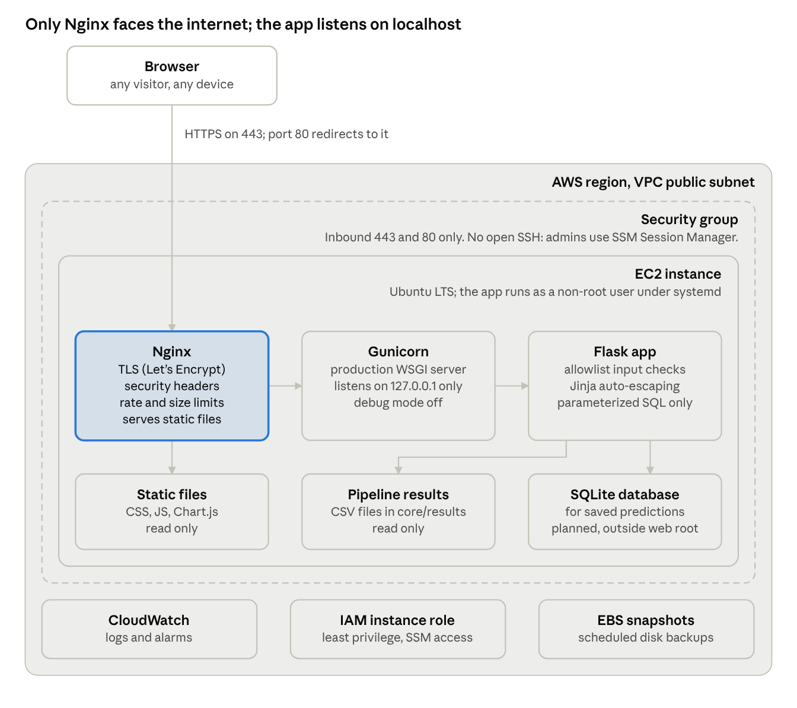

# Security Architecture and Testing Plan

Nov 1, 2026 · Tyler Bullard

The app is hard to attack today: it has no database, builds no file paths from user input, and checks its only user input against a fixed allowlist. The risks are in how it gets deployed and in the planned features (saved predictions, CSV export, share links, gene search), which add a database, file paths and user text. This plan locks in the safe patterns now and tests them before the app goes on EC2.

## 1. Where the app stands today

The Flask app has four entry points, and only one takes user input.

| Entry point | What the user sends | How it is handled today |
| --- | --- | --- |
| `GET /` | Nothing | Renders the page |
| `POST /` | `genes` checkbox values | Matched against a fixed allowlist of five gene combinations; anything else gets a fixed error message |
| `GET /api/curves` | Nothing | Returns JSON built once at startup from the pipeline CSVs |
| `GET /static/<path>` | A file path | Flask's built-in static route, which uses Werkzeug's `safe_join` |

**Baseline probe.** We ran the current code (Flask 3.1.3, Werkzeug 3.1.9) and attacked it directly.

| Check | Result |
| --- | --- |
| 11 path traversal variants on `/static` (`../`, URL-encoded, double-encoded, backslash, absolute paths) | All 404, nothing leaked. Two absolute-path forms return a 308 redirect that then 404s. |
| XSS payloads in `genes` (`<script>`, `onerror=`, `javascript:`) | Never reflected; the fixed error message is shown |
| SQL-style payload (`' OR '1'='1`) | Never reflected; there is no database |
| Security response headers | None: no Content-Security-Policy, X-Content-Type-Options, frame protection or HSTS |
| `Server` header | Discloses `Werkzeug/3.1.9 Python/3.11` |
| 5 MB form body / 5,000 form fields | Both accepted (no request size limit) |
| PUT, DELETE, TRACE | 405 Method Not Allowed |
| `pip-audit` on the 12 pinned packages | No known vulnerabilities (as of the date above) |
| `bandit` on `app.py` | No findings |

**Findings.**

| ID | Severity | Finding | Fix |
| --- | --- | --- | --- |
| F1 | High at deploy | The README runs the app with `flask --debug`. If the Werkzeug debugger is ever reachable from the internet, anyone can run code on the server. | Never use the dev server on EC2. Run Gunicorn with debug off, and add a test that fails if production config has `DEBUG` on. |
| F2 | Medium | No security headers | Set them in Nginx and in a Flask `after_request` hook (section 3) |
| F3 | Medium | No request size limit, so large bodies tie up workers | `MAX_CONTENT_LENGTH` in Flask plus `client_max_body_size` in Nginx |
| F4 | Low now, high later | `timelapse.js` builds the population panels with `innerHTML` and template strings that include `g.name` from the API. The names are server constants today; once they come from a database or user input, this becomes a DOM XSS hole. | Build those elements with `createElement` and `textContent` |
| F5 | Low | `Server` header reveals software versions | `server_tokens off` in Nginx; Gunicorn stays behind the proxy |
| F6 | Low | One inline `style` attribute (`--accent`) forces a weaker CSP (`style-src 'unsafe-inline'`) | Replace it with a CSS class per genotype |
| F7 | Future | No CSRF protection. Nothing changes state yet, but saving and sharing predictions will. | Add Flask-WTF `CSRFProtect` before those features ship |
| F8 | Info | Two `\|safe` filters in the template, both on hard-coded arrow characters. Safe as written. | Add a review rule: any new `\|safe` or `innerHTML` needs a second reviewer |

## 2. Target architecture on AWS EC2

The app runs on one EC2 instance behind Nginx. Nginx is the only process the internet can reach; Gunicorn and Flask listen only on the instance itself.



The app's Linux user can write only to the database folder. The modeling pipeline runs offline, and its result CSVs are copied in with each deploy, so the web server never runs COBRApy.

## 3. Controls per threat

Each threat gets one rule the code must follow and a backstop that limits the damage if the rule is ever broken.

### Path traversal

The rule: **user input never becomes part of a file path.** Planned features that serve files (CSV export, saved predictions, worm images for feature 7) look a file up by an ID the server controls, never by a name the user sends.

- Map IDs to files on the server: `EXPORTS = {"daf-2": "de_daf-2_vs_wt.csv", ...}`, then `send_from_directory(EXPORT_DIR, EXPORTS[key])`. An unknown key returns 404.
- Saved predictions use random IDs (`secrets.token_urlsafe(16)`) stored in the database, not file names.
- If a path ever has to be built from input, use `werkzeug.security.safe_join` (returns `None` when the path escapes the folder), then resolve it and confirm it is still inside the allowed folder.
- Backstop: the app's Linux user can read only `web/`, the pipeline results and the database folder. Nginx serves `/static` from a fixed folder with `autoindex off`.

### Cross-site scripting (XSS)

The rule: **the browser never treats data as code.**

- Jinja auto-escaping stays on for every template. `\|safe`, `Markup()` and `` are banned outside reviewed exceptions.
- In JavaScript, put data on the page with `textContent`, `setAttribute` or Chart.js options, never `innerHTML` or template strings (fixes F4). A lint rule enforces this (`no-unsanitized` for ESLint).
- JSON goes to the page through `/api/curves` and is read with `fetch`. It is never pasted into a `<script>` block.
- Backstop: a strict Content-Security-Policy, so even injected markup can't run scripts:

```
Content-Security-Policy: default-src 'self'; script-src 'self'; style-src 'self';
  img-src 'self' data:; object-src 'none'; base-uri 'self'; frame-ancestors 'none'; form-action 'self'
```

`style-src 'self'` works once F6 is fixed. Until then it needs `'unsafe-inline'`, which is acceptable for styles but should not stay.

### SQL injection

The rule: **queries are never built with string formatting.** This applies from the first line of database code (feature 12, saved predictions).

- Use SQLAlchemy's ORM or Core with bound parameters: `select(Prediction).where(Prediction.share_id == share_id)`.
- Raw SQL only through `text()` with named parameters: `text("SELECT * FROM predictions WHERE share_id = :sid")`. Never f-strings, `%` or `.format()`.
- Validate input shape before it reaches the database: share IDs match `^[A-Za-z0-9_-]{22}$`, gene names come from the allowlist.
- `bandit` (rule B608, SQL built from strings) and a Semgrep rule fail CI on string-built SQL.
- Backstop: the database file lives outside the web root (`/var/lib/wormlife/app.db`), owned by the app user with mode 600. The app can't run arbitrary SQL files, and backups are snapshots, not SQL dumps the app can read.

### Baseline for every request

- **Debug off in production** (F1): Gunicorn with `FLASK_DEBUG=0`. A test fails if production config has `DEBUG=True`.
- **Headers** (F2, F5): CSP as above, `Strict-Transport-Security: max-age=31536000`, `X-Content-Type-Options: nosniff`, `Referrer-Policy: same-origin`, `Permissions-Policy` with camera, mic and location off, `server_tokens off`.
- **Size and rate limits** (F3): `MAX_CONTENT_LENGTH = 16 KB` (the form is tiny), Nginx `client_max_body_size 16k`, and `limit_req` on `POST /`.
- **CSRF** (F7): Flask-WTF `CSRFProtect` on every POST, added together with the first feature that saves anything.
- **Secrets**: `SECRET_KEY` comes from an environment variable set by systemd, never from the repository. Session cookies are `Secure`, `HttpOnly` and `SameSite=Lax`.
- **Errors**: custom 404 and 500 pages that show no stack traces or file paths.

## 4. Testing strategy

Security tests run in six layers. The fast ones run on every push, so a regression is caught in minutes rather than on the server.

| Layer | What it checks | Tool | When it runs |
| --- | --- | --- | --- |
| Unit and route tests | Every payload in section 5 against every route; allowlist logic; config (debug off, size limit, cookie flags) | `pytest` with Flask's test client | Every push and pull request |
| Static analysis (SAST) | Python: string-built SQL, `debug=True`, unsafe file paths. JS: `innerHTML`, `eval`. Templates: new `\|safe`. | `bandit`, Semgrep (`p/flask`, `p/xss` rule packs), ESLint with `no-unsanitized` | Every push and pull request |
| Dependency scan | Known CVEs in pinned Python packages and the vendored Chart.js | `pip-audit`, GitHub Dependabot | Every push, plus a weekly scheduled run |
| Browser tests | The page really blocks injected script (CSP), DOM XSS through the time-lapse panels, error pages | Playwright (Python) | Every pull request to `main` |
| Dynamic scan (DAST) | Headers, cookies, injection and traversal from the outside, against the running stack | OWASP ZAP baseline scan, then the full active scan | Against a staging EC2 instance before each release |
| Manual review | Anything the tools can't judge: new features that touch files, the database or user text | Checklist in the pull request template | Every pull request that adds a route, a query or file access |

**How the tests are written.**

- **Payload lists, not single cases.** Each threat has a list of payloads (section 5) in `tests/security/payloads.py`. `pytest.mark.parametrize` runs every payload against every route that takes input, so a new route is covered by adding one line.
- **Assert on what must never happen,** not on exact responses. Path traversal: the response never contains a known marker from a file outside `static/` (a canary file `web/CANARY_DO_NOT_SERVE.txt` holds a unique string). XSS: the raw payload never appears unescaped in the HTML. SQL: no database error text appears, and the row count of the table is unchanged.
- **Test the production config.** A `create_app("production")` factory replaces the module-level `app` so tests can load the exact settings EC2 uses.
- **Future-proof by testing the pattern.** The database doesn't exist yet, so the SQL tests run against an in-memory SQLite fixture with a `predictions` table. When feature 12 is built, its real queries plug into the same tests.

**Targets.** Every route that takes input is covered by all three payload lists, `bandit` and Semgrep report zero high findings, `pip-audit` reports zero known vulnerabilities, and the ZAP baseline reports no medium or high alerts.

## 5. Test cases

Every case below becomes a parametrized `pytest` case. "Today" says whether the route exists yet. Cases for planned routes go in now and are marked `xfail` until the route ships, so the feature can't merge without passing them.

### Path traversal

Targets: `GET /static/<path>` today, and the planned CSV export and saved-prediction routes.

| ID | Payload (sent with `--path-as-is`) | Expected | Today |
| --- | --- | --- | --- |
| PT-01 | `/static/../app.py` | 404, no canary or source in body | Passes |
| PT-02 | `/static/..%2fapp.py` and `%2e%2e%2f` forms | 404 | Passes |
| PT-03 | Double-encoded `..%252fapp.py` | 404 | Passes |
| PT-04 | Backslash `..%5capp.py` (matters if the server ever runs on Windows) | 404 | Passes |
| PT-05 | Absolute paths `/static//etc/passwd`, `/static/%2fetc%2fpasswd` | 404 after any redirect | Passes (308, then 404) |
| PT-06 | Null byte `/static/main.css%00.js` | 400 or 404, never a file | Passes (404) |
| PT-07 | Export with an unknown or path-like key (`../../etc/passwd`, `daf-2/../../app.py`) | 404; only keys in the server's map work | Planned route |
| PT-08 | Saved prediction ID that isn't 22 URL-safe characters | 404 before the database is queried | Planned route |
| PT-09 | Nginx serves `/static/` with a trailing-slash alias trick (`/static../app.py`) | 404 (checks the Nginx `alias` config) | Staging only |

### Cross-site scripting

Targets: `POST /` (`genes`), planned gene search (feature 15) and planned share pages (feature 18).

| ID | Payload | Expected | Today |
| --- | --- | --- | --- |
| XSS-01 | `<script>alert(1)</script>` in `genes` | Not reflected; fixed error shown | Passes |
| XSS-02 | `">` | Not reflected, or escaped as `&lt;img` | Passes |
| XSS-03 | `javascript:alert(1)` | Not reflected | Passes |
| XSS-04 | `{{7*7}}` and `` (template injection) | Shown as typed text, never `49` | Passes (not reflected) |
| XSS-05 | Search box (feature 15) echoes `<svg onload=alert(1)>` | Escaped in the "no matches" message | Planned route |
| XSS-06 | Genotype name containing `` fed through `/api/curves` | Time-lapse panel shows it as text; no script runs (Playwright) | Fails until F4 is fixed |
| XSS-07 | Any page load | CSP header present and matches section 3; an injected inline script is blocked (Playwright listens for the CSP violation) | Fails until F2 is fixed |
| XSS-08 | `/api/curves` response | `Content-Type: application/json` and `X-Content-Type-Options: nosniff` | Half passes (nosniff missing) |

### SQL injection

Targets: planned saved predictions (feature 12) and share links (feature 18). These run against an in-memory SQLite fixture now.

| ID | Payload | Expected |
| --- | --- | --- |
| SQL-01 | Share ID `' OR '1'='1` | 404; no rows returned; rejected by the ID format check |
| SQL-02 | Share ID `x'; DROP TABLE predictions;--` | 404; table still exists with the same row count |
| SQL-03 | `1 UNION SELECT name, sql FROM sqlite_master--` | 404; no schema text in the response |
| SQL-04 | Time-based `' AND 1=(SELECT 1 FROM sqlite_master WHERE randomblob(100000000))--` | Responds in normal time; rejected by the format check |
| SQL-05 | Prediction label (if users can name saves) with `'); DELETE FROM predictions;--` | Stored and shown as plain text; no rows deleted |
| SQL-06 | Static check | `bandit` B608 and Semgrep find no f-string, `%` or `.format()` SQL anywhere in `web/` |

### Configuration and server

| ID | Check | Expected |
| --- | --- | --- |
| CFG-01 | Production config | `DEBUG` false, `TESTING` false, `SECRET_KEY` from the environment and at least 32 bytes |
| CFG-02 | Request of 20 KB to `POST /` | 413 Payload Too Large |
| CFG-03 | Response headers on `/`, `/api/curves`, a static file and a 404 | All section 3 headers present; no `Server` version |
| CFG-04 | Forced error (test-only route) | Generic 500 page; no stack trace, path or library name |
| CFG-05 | `POST /` without a CSRF token (once CSRF is added) | 400 |
| CFG-06 | Plain HTTP on port 80 (staging) | 301 redirect to HTTPS |
| CFG-07 | Port scan of the instance (staging) | Only 80 and 443 open |

## 6. EC2 deployment and server hardening

One small instance is enough for a research tool with modest traffic. The checklist below assumes Ubuntu LTS and the layout in section 2.

**AWS account and network**

- [ ] Root account has MFA and is not used day to day; each team member has their own IAM user with MFA
- [ ] Security group allows inbound 443 and 80 from anywhere, nothing else. No port 22: admins connect through SSM Session Manager.
- [ ] Instance has an IAM role with only `AmazonSSMManagedInstanceCore` and CloudWatch Agent permissions. No access keys stored on the server.
- [ ] IMDSv2 required (blocks the classic server-side request trick for stealing instance credentials)
- [ ] EBS volume encrypted; scheduled snapshots with AWS Backup or Data Lifecycle Manager
- [ ] Elastic IP and a domain name, so HTTPS certificates can be issued

**Operating system**

- [ ] `unattended-upgrades` on for security patches
- [ ] Dedicated `wormlife` user with no login shell runs the app; code is owned by root and read-only to that user
- [ ] Only the database folder (`/var/lib/wormlife`) is writable by the app user
- [ ] Host firewall (`ufw`) mirrors the security group as a second layer

**Nginx**

- [ ] TLS from Let's Encrypt (`certbot`), auto-renewing; TLS 1.2 and 1.3 only
- [ ] Port 80 redirects to 443; HSTS header set
- [ ] Security headers from section 3; `server_tokens off`
- [ ] `client_max_body_size 16k`; `limit_req` on `POST /`
- [ ] `/static/` served with `alias` paths that both end in a slash (prevents the off-by-slash traversal in PT-09); `autoindex off`
- [ ] Everything else proxied to Gunicorn on `127.0.0.1:8000`

**Gunicorn and the app**

- [ ] Runs under systemd as `wormlife`, with `NoNewPrivileges=true`, `ProtectSystem=strict`, `ProtectHome=true`, `ReadWritePaths=/var/lib/wormlife`
- [ ] `FLASK_DEBUG=0`; `SECRET_KEY` in a systemd environment file readable only by root, or in AWS SSM Parameter Store
- [ ] Binds to `127.0.0.1` only, never `0.0.0.0`
- [ ] Dependencies installed from the pinned `requirements.txt` into a virtual environment

**Monitoring**

- [ ] Nginx access/error logs and app logs shipped to CloudWatch Logs
- [ ] Alarms on 5xx rate, CPU, disk space and failed certificate renewal
- [ ] Logs never record form contents beyond the gene names

An Application Load Balancer with an AWS Certificate Manager certificate (and optionally AWS WAF) is the step up if the app later needs more than one instance. It adds monthly cost, so it isn't in the first deployment.

## 7. The testing round

The round has three stages, in order. Each stage depends on the one before, so they should not run in parallel.

**Stage 1: harness and fixes (local and CI)**

- [ ] Refactor `app.py` into a `create_app(config_name)` factory with `development`, `testing` and `production` configs
- [ ] Add `tests/security/` with `payloads.py` and parametrized tests for every PT, XSS, SQL and CFG case in section 5; planned routes marked `xfail`
- [ ] Add the canary file and the in-memory SQLite fixture with a `predictions` table
- [ ] Fix F2 and F3: security headers in an `after_request` hook, `MAX_CONTENT_LENGTH`
- [ ] Fix F4: build the time-lapse panels with `createElement` and `textContent`
- [ ] Fix F6: replace the inline `--accent` style with a class per genotype, then tighten the CSP to `style-src 'self'`
- [ ] Add a GitHub Actions workflow (`.github/workflows/security.yml`) running `pytest`, `bandit`, Semgrep, ESLint and `pip-audit` on every push and pull request
- [ ] Turn on Dependabot alerts and branch protection on `main` (CI must pass, one reviewer)
- [ ] Update the README so `--debug` is clearly marked as local development only

**Stage 2: staging on EC2**

- [ ] Launch a staging instance using the section 6 checklist
- [ ] Run the server-side cases there: PT-09, CFG-03, CFG-06, CFG-07
- [ ] Run the OWASP ZAP baseline scan, fix or document every alert, then run the full active scan
- [ ] Run the Playwright browser tests (XSS-06, XSS-07) against staging

**Stage 3: release**

The app goes to production only when every item below is true:

- [ ] All security tests pass; `xfail` only on routes that don't exist yet
- [ ] `bandit` and Semgrep: zero high-severity findings
- [ ] `pip-audit` and Dependabot: zero known vulnerabilities, or each one documented with a reason it doesn't apply
- [ ] ZAP: no medium or high alerts
- [ ] Section 6 checklist complete for the production instance
- [ ] Findings F1 to F6 closed

**Before each planned feature ships**, its tests move from `xfail` to required: saved predictions (feature 12) need CSRF (F7), SQL-01 to SQL-06 and PT-08; gene search (feature 15) needs XSS-05; share links (feature 18) need PT-08 and the SQL cases.

## 8. Open questions

- **Who can use the site?** If it's open to anyone, the plan stands as written. If it's limited to the lab or the class, add login (or put it behind the university VPN), which changes the session and CSRF design.
- **Is there a domain name?** HTTPS certificates need one. A free subdomain works, but the team should decide who owns it.
- **Whose AWS account, and what budget?** That decides whether staging is a second instance or the same instance with a separate port.
- **Will users name or describe saved predictions?** If yes, that free text is the main XSS and SQL injection surface, and SQL-05 and XSS-05 become release blockers for feature 12.
- **Does the Tkinter prediction viewer ship to anyone?** It reads local CSVs and doesn't touch the web app, so it's out of scope here unless the team distributes the `.exe`.
